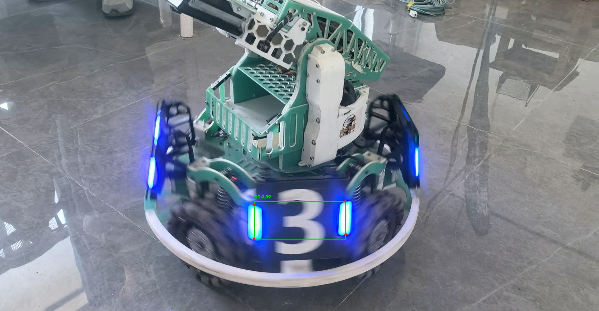

# YOLOv26 装甲板推理与关键点可视化

## 1. 项目完成的功能
- 使用提供的 YOLOv26 模型 (`best.pt`) 对自行拍摄的装甲板视频进行推理。
- 识别 B1, B2, B3, R1, R2, R3 六类装甲板。
- 绘制检测框、类别标签、置信度，并使用红点绘制模型预测的 4 个关键点。
- 保存并输出可视化推理视频。

## 2. 环境依赖 (Python版本、主要依赖、CPU/GPU)
- **Python 版本**: [3.10.20]
- **主要依赖**: `ultralytics`, `opencv-python`
- **硬件要求**: 本机运行环境为 [Intel U7 + RTX 5060]，推理时使用的是 [GPU]。

## 3. 模型权重的准备方式与放置位置
- 权重文件 `best.pt` 未提交至 Git 历史中（已通过 `.gitignore` 排除）。
- **准备方式**: 请从作业参考材料中下载 `best.pt`，并将其放置在项目根目录下（与 `infer.py` 同级）。

## 4. 依赖安装步骤、实际运行命令和结果保存位置
- **安装依赖**:
  ```bash
  pip install -r requirements.txt
## 5.视频拍摄地点、时长及场景说明
- **拍摄地点**:水建学院
- **时长**:14s
- **场景说明**:竖屏拍摄，有清晰的装甲板拍摄画面
## 6.推理结果截图

## 7. 实际识别表现、遇到的问题及处理方法
- 整体基本识别准确，但是在侧边识别置信度并不高